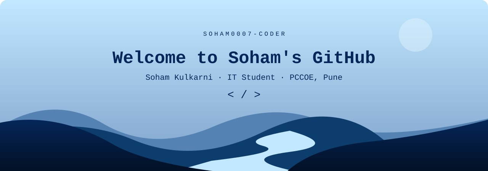
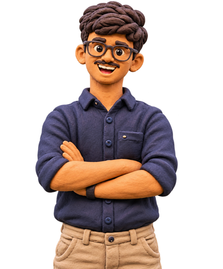
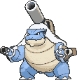

  

  <b>Python · Generative AI · Hackathons</b> 
  Learning, building, and leveling up one project at a time.

<h2 align="center"> About Me</h2>

Hi! I'm **Soham Kulkarni**, an **Information Technology student at PCCOE, Pune**.

I enjoy exploring **Python** and **Generative AI**, turning ideas into working software, and learning by building. Hackathons give me a chance to experiment, solve problems with a team, and try something new.

- 🎓 Studying Information Technology at PCCOE, Pune.
- 🐍 Exploring Python through practical projects.
- 🤖 Interested in Generative AI and useful AI applications.
- ⚡ Always up for a hackathon and a new challenge.

 

<h2 align="center"> Technologies & Interests</h2>

  
  
  
  

<h2 align="center"> GitHub Activity</h2>

  

  <a href="https://github.com/SOHAM0007-CODER?tab=repositories">Explore my repositories →</a>

<h2 align="center"> Hobbies & Goals</h2>

### Next quest: keep building.

My goals are to get better at Python, explore what I can build with Generative AI, and take on more hackathon challenges with curious teammates.

**Pokémon companion: Mega Blastoise** 🌊

*A little curiosity. A lot of practice. One more level.*

 

  
  Thanks for stopping by — see you on the next quest!

<!-- Design inspiration and asset credits are recorded in CREDITS.md. -->
